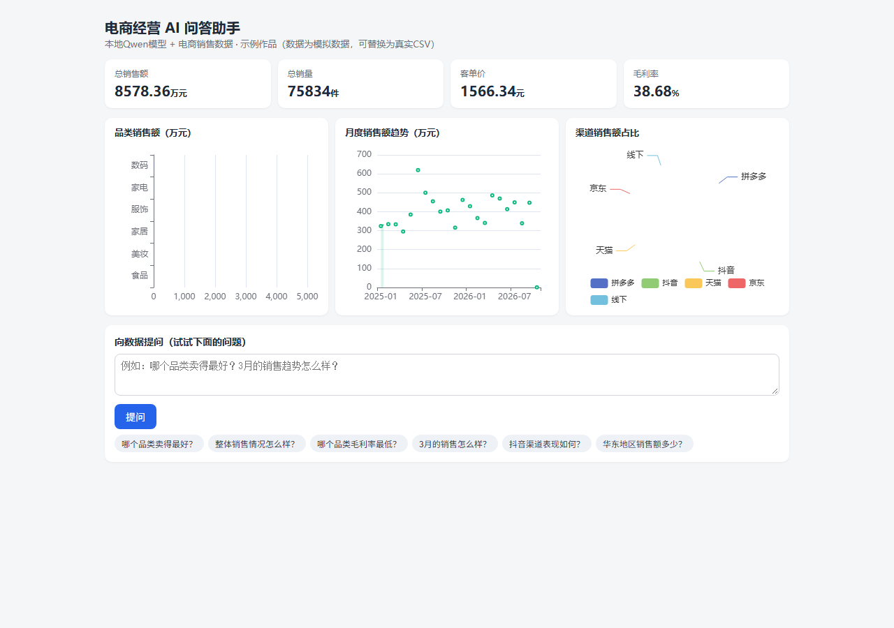

# 电商经营 AI 问答助手

一个本地运行的「AI 应用运营」求职作品：把电商销售数据变成能自然语言问答的助手。

**数据 → 指标计算 → 规则路由 + 本地大模型 → 网页问答**，一条完整可演示的 AI 应用链路。

## 作品预览



***

## 快速开始

**环境要求**：Python 3.10+；本地模型模式需要已安装 Ollama 并拉取 `qwen2.5:7b`；云端模式需要 OpenAI 兼容 API Key（见下文"换成云端模型"）。

```bash
# 1. 安装依赖
pip install flask pandas requests

# 2. 启动
python app.py
```

启动后打开浏览器 `http://127.0.0.1:8000`，就可以向数据提问了。

> Windows 本机作者用法：双击 `start.bat` 或运行 `E:\python\python.exe app.py`（作者环境为 E 盘部署）。


***

## 架构（面试讲解就用这张图）


```
┌─────────────┐    ┌──────────────────┐    ┌────────────────────┐    ┌─────────────┐
│ 数据层       │ →  │ 计算层            │ →  │ 问答层              │ →  │ 展示层       │
│ ecommerce_  │    │ pandas 清洗 +     │    │ ①关键词规则路由→取数据 │    │ Flask 网页   │
│ sales.csv   │    │ 预计算业务指标     │    │ ②本地Qwen组织运营语言 │    │ 仪表盘+问答  │
└─────────────┘    └──────────────────┘    └────────────────────┘    └─────────────┘
   4000行模拟数据     KPI/品类/月度/渠道/地区    规则保证"数据是真的"，   浏览器打开
   可换成真实CSV      毛利率/客单价等            模型保证"话说得像人"     即可演示
```

**为什么这样设计（这是面试里最能讲的一段）**：


* **规则拿数据、模型说人话**：7B 小模型直接读原始数据容易编数字。先由 pandas 算好指标、规则命中问题后把**真实数据**喂给模型，模型只负责组织语言 —— 数据可信度由代码保证，不靠模型自觉。

* **模型能力边界的理解**：本地 7B 模型推理弱，所以让它做 "翻译器" 而不是 "分析器"；要更强分析就切云端大模型（见下）。

* **可切换模型**：同一套代码，改三行配置就能从本地 Ollama 切到 DeepSeek / 豆包等任意 OpenAI 兼容 API—— 这是 AI 应用运营的日常能力：**换模型不改架构**。


***

## 怎么提问（演示时先用这些）


| 问题         | 命中的能力           |
| ---------- | --------------- |
| 哪个品类卖得最好？  | 规则路由 → TOP 品类数据 |
| 整体销售情况怎么样？ | KPI 指标          |
| 哪个品类毛利率最低？ | 毛利率排行           |
| 3 月的销售怎么样？ | 月份识别 → 月度数据     |
| 抖音渠道表现如何？  | 渠道对比            |
| 华东地区销售额多少？ | 地区对比            |
| （任意没预设的问题） | 模型兜底：基于数据摘要回答   |


***

## 换成你的真实数据 / 换成云端模型

**换数据**：把 `data/ecommerce_sales.csv` 替换成你自己的 CSV，字段名保持一致：

`date, category, channel, region, sales_volume, unit_price, unit_cost, customer_count`。

（如果你的数据字段不同，改 `app.py` 顶部的 `DATA_PATH` 和 `load_data()` 里的列名即可）

**换模型**（DeepSeek 示例）：


```
MODEL_API_BASE = "https://api.deepseek.com"
MODEL_API_PATH = "/chat/completions"
MODEL_NAME = "deepseek-chat"
MODEL_API_KEY = "sk-你的key"
```

**重新生成模拟数据**（可选）：

```
python generate_data.py
```


***

## 面试话术（把这个作品讲清楚，就是一次 "AI 应用运营" 面试）

> 我做了一个电商经营问答助手：数据进来后先用 pandas 做清洗和指标预计算，把销售额、毛利率、品类排行这些算好；用户提问时先用关键词规则命中要取哪部分数据，再把这个真实数据发给本地部署的 Qwen 模型，让模型组织成运营语言回答。这样设计是因为 7B 小模型直接读原始数据会编造数字，所以数据可信度用规则代码保证，模型只负责表达 —— 这也是我对模型能力边界的理解。整套东西在本地跑通，也可以三行配置切到 DeepSeek 的云端 API，因为我理解 AI 应用运营的核心是 "换模型不改架构、数据不出错、结果可演示"。


***

## 文件清单


| 文件                         | 作用                         |
| -------------------------- | -------------------------- |
| `app.py`                   | 主程序：Flask 服务 + 指标引擎 + 问答引擎 |
| `generate_data.py`         | 生成模拟电商数据（可复现）              |
| `start.bat`                | 双击启动器                      |
| `data/ecommerce_sales.csv` | 模拟销售明细数据                   |
| `docs/dashboard.png`       | 作品演示截图                     |

***

## 在线版（预告）

本作品当前为**本地部署版**（需要 Python + 本地模型运行，所以不能像静态网页那样用 GitHub Pages 直接点开）。

下一步计划：把模型切换为云端 API（如 DeepSeek），部署到免费平台拿到**真·在线链接**——代码一行不改，因为设计上就是"换模型不改架构"。


***

## 已知边界（诚实交代，面试也是加分点）


* 数据是模拟的；换成真实数据后结论才有业务含义。

* 规则路由覆盖常见运营问题；冷门问题走模型兜底，回答质量取决于小模型能力，切云端大模型可显著改善。

* 图表依赖 ECharts CDN，离线时图表不显示，但文字问答不受影响。